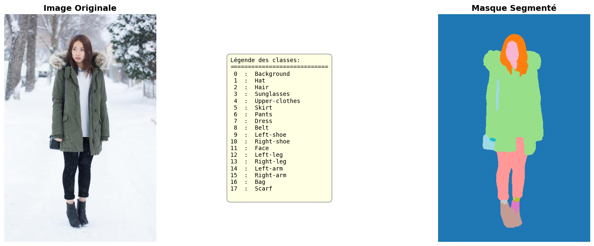

# Analyse et segmentation de vêtements

## Présentation

Ce projet est une première initiation guidée à la segmentation d'images à l'aide d'un notebook Python.

L'objectif est de tester un modèle d'intelligence artificielle capable d'identifier les vêtements et certaines parties du corps visibles sur des photographies d'influenceurs. Le projet utilise le modèle [`sayeed99/segformer_b3_clothes`](https://huggingface.co/sayeed99/segformer_b3_clothes), accessible via l'API d'inférence Hugging Face.

Le notebook explique progressivement comment :

- configurer l'environnement Python ;
- authentifier les requêtes auprès de Hugging Face ;
- envoyer une image à l'API ;
- récupérer et décoder les masques de segmentation ;
- associer chaque masque à une catégorie de vêtement ;
- visualiser l'image originale et le résultat de segmentation ;
- traiter plusieurs images avec une gestion des erreurs et des tentatives de relance.

## Prérequis

- Un compte GitHub pour versionner le projet ;
- un compte Hugging Face ;
- Python installé sur la machine ;
- Visual Studio Code ou PyCharm ;
- Git ;
- un terminal ou une invite de commande.

Le projet est actuellement configuré dans `pyproject.toml` pour Python `3.14` ou une version supérieure. Le brief pédagogique indique Python 3.8 ou supérieur, mais il est recommandé de respecter la version déclarée dans le projet pour éviter les incompatibilités.

## Installation

Depuis le répertoire du projet, créer et activer un environnement virtuel :

```bash
python -m venv .venv
```

Sous Windows PowerShell :

```powershell
.venv\Scripts\Activate.ps1
```

Installer ensuite les dépendances du projet :

```bash
pip install -e .
```

Les principales bibliothèques utilisées sont `requests`, `Pillow`, `numpy`, `matplotlib`, `python-dotenv`, `huggingface-hub`, `jupyter` et `tqdm`.

## Configuration du token Hugging Face

Le notebook utilise un token personnel pour appeler l'API d'inférence.

1. Ouvrir la page [Access Tokens de Hugging Face](https://huggingface.co/settings/tokens).
2. Créer un token avec les droits de lecture uniquement (`read`).
3. Créer un fichier `.env` à la racine du projet.
4. Ajouter le token dans ce fichier :

```dotenv
SECRET_KEY=hf_votre_token
```
## Organisation du projet

```text
.
├── huggingface_api_cloth_seg.ipynb
├── Exemple_Viz_segmentation_dataset.ipynb
├── main.py
├── pyproject.toml
├── IMG/
│   └── images à segmenter
├── Mask/
│   └── masques de référence éventuels
└── .env
```

Le dossier `IMG/` contient les images transmises au modèle. Le dossier `Mask/` peut contenir des masques de référence, utiles pour comparer les prédictions du modèle à une annotation connue.

## Utilisation du notebook

1. Ouvrir `huggingface_api_cloth_seg.ipynb` dans Visual Studio Code ou Jupyter.
2. Sélectionner l'interpréteur Python de l'environnement `.venv`.
3. Vérifier que le fichier `.env` contient un token Hugging Face valide.
4. Vérifier le chemin `image_dir` et le nombre d'images dans `max_images`.
5. Exécuter les cellules dans l'ordre.

Le notebook commence par une image afin de vérifier le fonctionnement de l'API, puis propose un traitement par lot. Les images trop grandes peuvent être écartées selon les dimensions maximales configurées. Des délais d'attente, des tentatives de relance et une pause entre les requêtes limitent les problèmes liés au réseau ou aux limites de l'API.




## Catégories segmentées

Le masque final associe un identifiant numérique aux catégories suivantes :

`Background`, `Hat`, `Hair`, `Sunglasses`, `Upper-clothes`, `Skirt`, `Pants`, `Dress`, `Belt`, `Left-shoe`, `Right-shoe`, `Face`, `Left-leg`, `Right-leg`, `Left-arm`, `Right-arm`, `Bag` et `Scarf`.

Une palette de couleurs est utilisée pour rendre ces catégories visibles dans les visualisations.

## Résultats attendus

Le projet doit permettre d'obtenir :

- une segmentation produite par l'API Hugging Face pour chaque image ;
- un masque combiné représentant les classes détectées ;
- une visualisation côte à côte de l'image originale et du masque ;
- une visualisation en lot pour comparer plusieurs images ;
- une première analyse qualitative des performances du modèle.

## Évaluation du modèle

Pour réaliser une évaluation quantitative, il faut disposer de masques de référence correspondant aux images traitées, par exemple dans `Mask/`. Les prédictions peuvent ensuite être comparées aux annotations avec des métriques de segmentation telles que :

- l'Intersection over Union (IoU) ;
- le Dice Score ;
- le F1-score par classe.

Une démarche complète consiste à séparer les données en jeux d'entraînement, de validation et de test. Dans ce projet d'initiation, le modèle est déjà entraîné et utilisé via une API : l'objectif principal est donc de tester ses prédictions sur un jeu d'images et d'analyser les résultats, plutôt que de réentraîner le modèle.

## Points de vigilance

- Vérifier la compatibilité entre la version de Python et les dépendances installées.
- Ne jamais exposer le token Hugging Face.
- Vérifier le format et les dimensions des images avant l'envoi.
- Prévoir les erreurs réseau, les timeouts et les limites de requêtes de l'API.
- Traiter progressivement les images afin d'éviter de surcharger le service.
- Interpréter les résultats avec prudence : une segmentation visuellement plausible ne garantit pas une bonne précision pour toutes les classes.

## Ressources

- [Documentation Python sur les environnements virtuels](https://docs.python.org/3/library/venv.html)
- [Documentation Hugging Face](https://huggingface.co/docs)
- [Documentation de l'API d'inférence Hugging Face](https://huggingface.co/docs/api-inference/index)
- [Modèle segformer_b3_clothes](https://huggingface.co/sayeed99/segformer_b3_clothes)
- [Documentation Pillow](https://pillow.readthedocs.io/)
- [Documentation Matplotlib](https://matplotlib.org/stable/)
